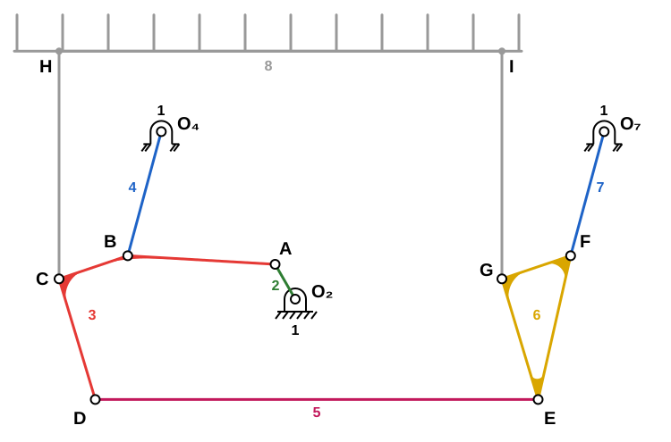
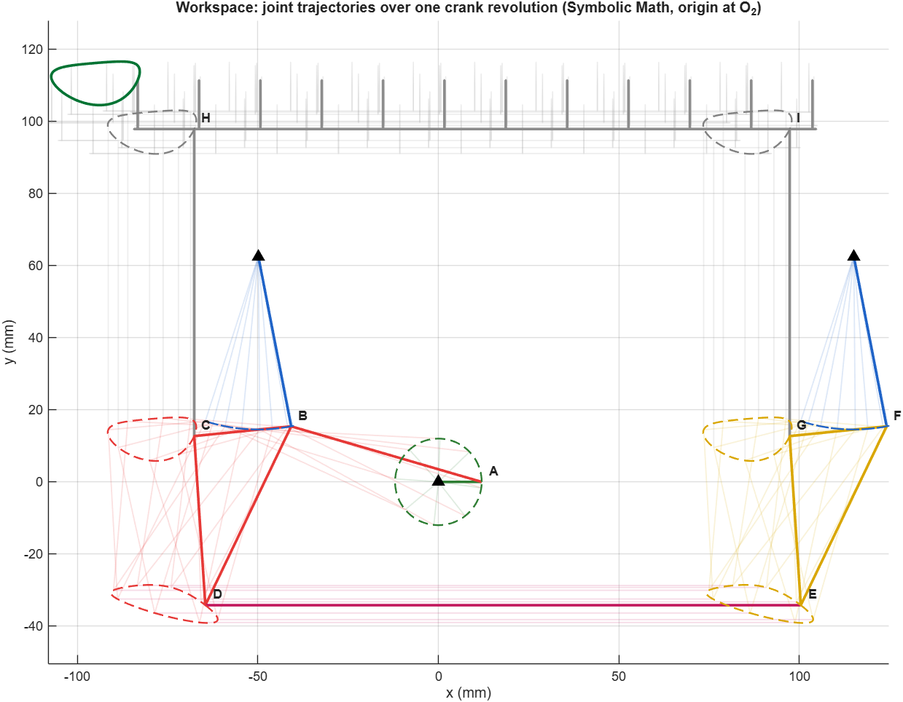
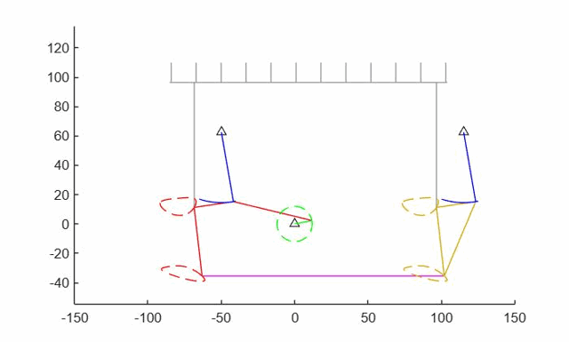
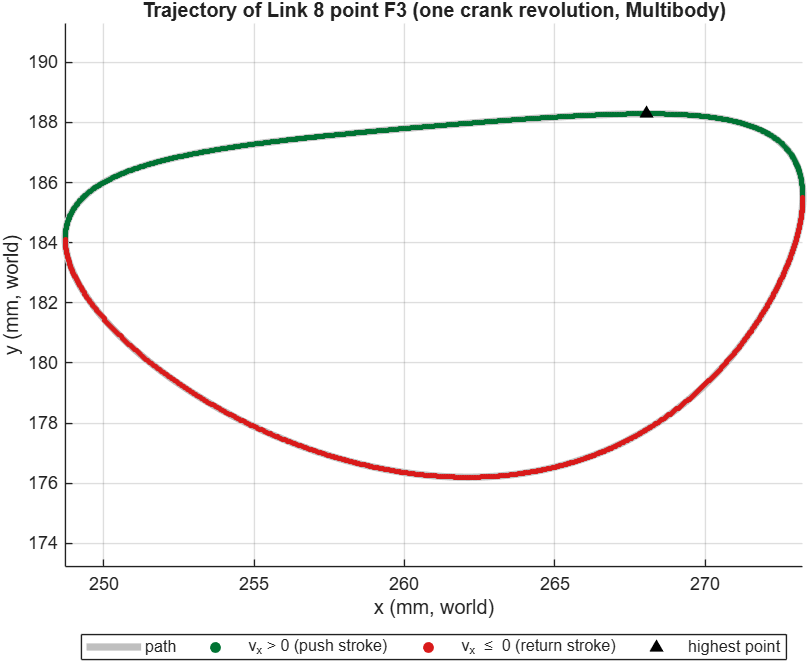
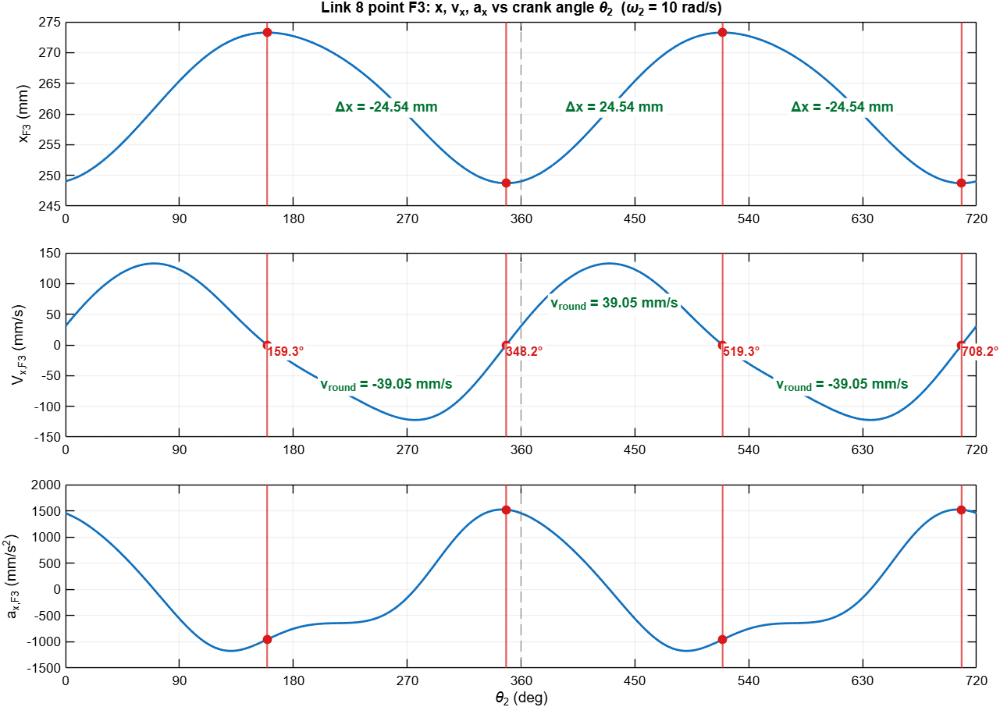
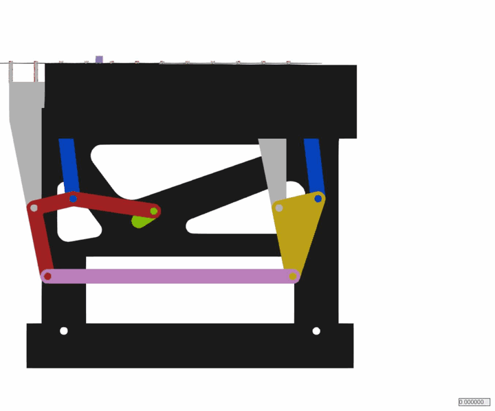
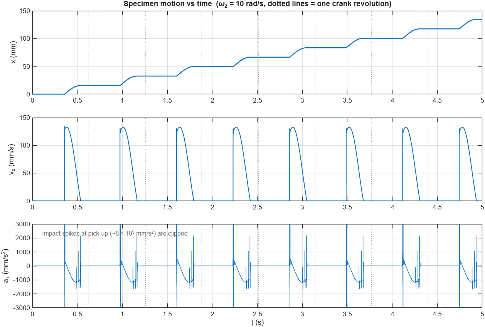

# Walking Beam Mechanism

Term project for **2103-322 Design of Mechanism (2569)**. A single crank drives an eight-bar linkage whose top beam (Link 8) carries a row of 12 teeth. Every crank revolution, the teeth move forward along the top of a closed loop and come back along the bottom, so a workpiece on the support surface is pushed forward one step at a time. The mechanism is studied with three consistent methods: symbolic mathematics, multibody simulation and an A4 wall-mounted physical model.

## Project overview

- **Project name:** Walking beam mechanism
- **purpose:** Move small workpieces step by step along a fixed support using one continuously rotating input. The beam moves forward while pushing the workpiece, then returns along a different path to pick up the next step. This intermittent motion is what conveyors, transfer presses and assembly lines use.
- **Team:**
  - Chayakorn Tantasutanon 6730095421: Simscape Multibody
  - Chayaphol Thawinsook 6730098321: Hardware
  - Nattapong Siriwatphatsakorn 6730150221: MATLAB symbolic math
- **Input condition (shared by all methods):** Link 2 rotates at a constant **ω₂ = 10 rad/s** (95.5 rpm, period T = 0.628 s)
- **Status:** Planning
- **Last updated:** 2026-11-19

## 1. Kinematic diagram and degrees of freedom

### Links

| Link | Joints | Description |
|---|---|---|
| 1 | O₂, O₄, O₇ | Ground (frame) |
| 2 | O₂A | Crank (input), length 12 mm |
| 3 | ABCD | Rigid plate carrying the coupler A–B and the beam pivot C (left side) |
| 4 | O₄B | Left rocker, 48 mm |
| 5 | DE | Connecting bar between the left and right plates, 165 mm |
| 6 | EFG | Rigid plate carrying the beam pivot G (right side) |
| 7 | O₇F | Right rocker, 48 mm (same as Link 4) |
| 8 | CG | Walking beam with 12 teeth (pitch 17 mm, height 13.537 mm). H and I mark its top corners |

### Joints

All 10 joints are revolute (1-DOF lower pairs): **O₂, O₄, O₇, A, B, C, D, E, F, G**.

### Degrees of freedom (Gruebler–Kutzbach)

$$
M = 3(n - 1) - 2j_1 - j_2 = 3(8 - 1) - 2(10) - 0 = 1
$$

With n = 8 links, j₁ = 10 revolute joints and j₂ = 0 higher pairs, the mechanism has **one degree of freedom**. A single input (the crank angle θ₂) fixes the position of every link, which is why one motor is enough to drive it.

**What this means for the mechanism:** Links 4 and 7 have the same length and Links 3 and 6 move in the same way, so Link 8 does not rotate. It only translates. Every point on the beam, including all 12 teeth, follows the **same closed path**, just shifted by the tooth pitch. That is why all teeth push together, and why one reference point on the beam (point **F3**, a frame on one tooth face of Link 8) describes the motion of every tooth.

### Grashof condition of the driving four-bar (O₂–A–B–O₄)

The motion starts in the four-bar loop formed by the ground O₂O₄, the crank O₂A, the coupler AB (side of plate ABCD) and the rocker O₄B.

| Link | Length (mm) | Role |
|---|---|---|
| O₂O₄ (ground) | 80.0 | l (longest) |
| O₂A (crank) | 12 | s (shortest) |
| AB (coupler, on ABCD) | 55 | p |
| O₄B (rocker) | 48 | q |

$$
s + l = 12 + 80 = 92 \;<\; p + q = 55 + 48 = 103
$$

The loop is a **Grashof linkage**. The shortest link (O₂A) is next to the ground, so it is a **crank–rocker**: O₂A can rotate a full 360°, and O₄B only swings back and forth.

| Result | Value |
|---|---|
| Rocker O₄B swing | 29.9° (between 26.8° and 56.7° from O₄O₂) |
| Crank angle between the two rocker limits | 186.6° one way, 173.4° the other (time ratio 1.08) |
| Transmission angle μ (between AB and O₄B) | 82.3° to 126.4° (the worst case, 126.4°, is 53.6° from a straight line) |

**What this means for the mechanism:**
- **Continuous input:** because the loop is a Grashof crank–rocker, a motor can turn Link 2 continuously at ω₂ = 10 rad/s with no dead point.
- **Same motion on both sides:** the rocker O₇F has the same length and is moved by the same plate motion, so the right side follows the left side.
- **Drives the beam loop:** the crank turns the oscillation of the rocker and the motion of plate ABCD into the closed loop of the beam pivot C, and so of every tooth.
- **Smooth motion transfer:** μ stays between 82.3° and 126.4°, so the coupler and rocker never come within 53.6° of being in line. This is well inside the usual 40°–140° design range, so the linkage runs smoothly without locking.

## 2. Working space

### Symbolic model (MATLAB Symbolic Math Toolbox)

The dashed curves are the joint paths over one crank revolution, and the faint outlines show the linkage every 44°. The solid green loop is the path of one tooth tip. The origin is at O₂.

- **Crank pin A:** a full circle (r = 12 mm), confirming the crank rotates fully.
- **Rockers (B and F):** oscillate on arcs about O₄ and O₇.
- **C, G and every tooth tip:** trace the same closed loop, **24.5 mm wide and 12.1 mm tall**.
- **Overall envelope** (pin centres and tooth tips): about 233 × 156 mm, which fits the required A4 (297 × 210 mm) wall-mounted area.

The animation of the symbolic model (from `fanimator` in [`Symbolic_Math.mlx`](simulation/Symbolic/Symbolic_Math.mlx)) shows the crank turning and every link following the loop-closure solution. The original video is [`media/Symbolic_Math.avi`](media/Symbolic_Math.avi).

### Multibody model (Simscape Multibody)

The Multibody model shows the tooth motion more clearly by plotting the trajectory of point **F3**, the center point of a tooth on Link 8. Because Link 8 only translates, this one curve is the path that every tooth follows.

The path of tooth on Link 8, in world coordinates, over one crank revolution:

| Quantity | Value |
|---|---|
| Horizontal range | x = 248.71 – 273.25 mm (stroke **24.54 mm**) |
| Vertical range | y = 176.20 – 188.29 mm (lift **12.08 mm**) |

**What this means for the mechanism:**
- **Push stroke (upper half, green, vₓ > 0):** the teeth are high, so they are above the support surface and push the workpiece forward.
- **Return stroke (lower half, red, vₓ ≤ 0):** the teeth drop below the surface and move back underneath the workpiece without dragging it back.
- **Agreement between methods:** the symbolic and multibody models give the same stroke (24.5 mm) and lift (12.1 mm).

## 3. Simulation

| File | Content |
|---|---|
| [`simulation/Multibody/walking_beam.slx`](simulation/Multibody/walking_beam.slx) | Simscape Multibody model (MATLAB R2026a) built from the CAD parts (`.step`) |
| [`simulation/Multibody/plot_F3_vs_theta2.m`](simulation/Multibody/plot_F3_vs_theta2.m) | Post-processing script, run automatically by the model's StopFcn (x, v, a of F3; push distance and speed) |
| [`simulation/Symbolic/Symbolic_Math.mlx`](simulation/Symbolic/Symbolic_Math.mlx) | Symbolic loop-closure solution and animation |
| [`media/multibody.avi`](media/multibody.avi) | Multibody simulation video |
| [`media/Symbolic_Math.avi`](media/Symbolic_Math.avi) | Symbolic model animation |
| [`media/hardware.mp4`](media/hardware.mp4) | Physical model in operation |

### Model setup
Multibody model
- **Input:** Joint O₂ is driven by motion, θ₂(t) = 10t rad, so ω₂ = 10 rad/s. Simulation time is 5 s, about 8 crank revolutions.
- **Workpiece (specimen):**
  - Shape: a 5 × 30 × 5 mm
  - Joint: on a Planar Joint, so it can slide, lift and tilt in the mechanism plane
- **Contact (Spatial Contact Force):**
  - Teeth: a 372-point Point Cloud on all 12 teeth of Link 8
  - Support surface: an Infinite Plane
  - Friction: smooth stick-slip, μs = 0.4, μk = 0.3
  - Purpose: the contact model is there so the path of the specimen can be seen as the teeth push it along. It is not used for force analysis, because the forces involved are very small and have little effect on the mechanism.

## 4. Position, velocity and acceleration analysis

### 4.1 Middle point of tooth (F3) on Link 8 vs crank angle

The red lines mark the crank angles where vₓ = 0. These are the two ends of the stroke, θ₂ = 348.2° (rear end) and 159.3° (front end). They split each revolution into a push stroke (vₓ > 0) and a return stroke (vₓ < 0).

#### Push distance per crank revolution

| Stroke | θ₂ range | Crank angle | Time | Δx |
|---|---|---|---|---|
| Push (vₓ > 0) | 348.2° → 519.3° (= 159.3° next rev.) | 171.1° | 0.299 s | **+24.54 mm** |
| Return (vₓ < 0) | 159.3° → 348.2° | 188.9° | 0.330 s | −24.54 mm |

**What this means for the mechanism:** each crank revolution, every tooth moves forward **24.54 mm** while it is in the pushing position. This is the largest possible step the mechanism can give a workpiece. The return stroke uses more crank angle than the push stroke (188.9° vs 171.1°, a time ratio of 1.10), so the teeth push slightly faster than they return.

#### Pushing speed per crank revolution

The forward distance of each stroke is divided by the time of one crank revolution, so the result can be compared directly with the workpiece speed (section 4.2):

$$
v_{\text{round}} = \frac{\Delta x}{t_{\text{round}}}, \qquad t_{\text{round}} = \frac{2\pi}{\omega_2} = \frac{2\pi}{10} = 0.628\ \text{s}
$$

| Stroke | Δx | v_round = Δx / t_round | Peak vₓ |
|---|---|---|---|
| Push | +24.54 mm | **+39.05 mm/s** | 132.7 mm/s |
| Return | −24.54 mm | −39.05 mm/s | −122.3 mm/s |

**What this means for the mechanism:** per crank revolution, the teeth move forward at an effective rate of **39.05 mm/s**. This is the upper limit of the conveying speed, reached only if the whole stroke moved the workpiece. The actual workpiece speed is lower (27.1 mm/s, see section 4.2 and the Summary). Because t_round = 2π/ω₂, the speed scales directly with ω₂, so doubling the motor speed doubles it.

#### Acceleration

The acceleration aₓ of F3 ranges from **−1174 to +1525 mm/s²**.

**What this means for the mechanism:**
- **Largest acceleration (+1522 mm/s²):** occurs at the rear end of the stroke (θ₂ = 348.2°), where the teeth reverse and start the push.
- **Strong deceleration (−957 mm/s²):** occurs at the front end (θ₂ = 159.3°).
- **Effect on the workpiece:** the reversal points are where the teeth start and stop pushing the workpiece, so its motion changes most abruptly there.

An average acceleration per stroke is not reported. Each stroke starts and ends at vₓ = 0, so its average acceleration is always zero.

### 4.2 Workpiece (specimen) motion vs time

The Multibody simulation shows the specimen (purple block on top) being pushed forward one step by the teeth of Link 8 in each crank revolution, then resting while the beam returns underneath it. The original video is [`media/multibody.avi`](media/multibody.avi).

| Quantity | Value |
|---|---|
| Advance per crank revolution (steady state) | **17.0 mm**, equal to the tooth pitch |
| Average conveying speed | 26.9 mm/s (17.0 mm / 0.628 s) |
| Time moving per revolution | about 0.19 s (30%), then at rest for about 0.44 s |
| Peak workpiece speed | 134.9 mm/s, which matches the peak tooth speed |
| Workpiece acceleration while carried | follows the tooth deceleration, down to about −1200 mm/s² (plus short spikes at contact) |

**What this means for the mechanism:**
- **Step-and-dwell motion:** the workpiece does not move continuously. In each revolution it is picked up, pushed, and then left at rest while the beam returns. This gives the staircase shape of x(t).
- **Advance per revolution:**
  - During the return stroke, the tooth in front of the workpiece passes underneath it.
  - On the next push stroke, that tooth pushes it.
  - So the workpiece is handed from tooth to tooth and advances exactly **one tooth pitch (17 mm)** per revolution, not the full 24.54 mm stroke. The other 7.5 mm of the stroke is used to close the gap before the tooth reaches the workpiece.
- **Speed:** while being pushed, the workpiece moves at the tooth speed. Its velocity drops to zero at the front end of the stroke (θ₂ = 159.3°), where the teeth stop.

## 5. Summary

| Topic | Result |
|---|---|
| Mechanism | Eight-bar walking beam driven by one crank at ω₂ = 10 rad/s (T = 0.628 s) |
| Degrees of freedom | M = 3(8 − 1) − 2(10) = **1**, so one motor drives the whole mechanism |
| Grashof (O₂–A–B–O₄) | 12 + 80 = 92 < 55 + 48 = 103, a **crank–rocker**: the crank turns fully, the rocker swings 29.9°, and μ stays between 82.3° and 126.4° |
| Beam motion | Link 8 only **translates**, so all 12 teeth follow the same closed loop |
| Tooth loop (workspace) | **24.54 mm** stroke × **12.08 mm** lift; Symbolic and Multibody models agree |
| Overall size | about 233 × 156 mm, within the A4 wall-mounted area |
| Push / return stroke | 171.1° / 188.9° of crank angle (time ratio 1.10) |
| Tooth speed per revolution | v_round = 24.54 mm / 0.628 s = **39.05 mm/s** |
| Workpiece advance | **17.0 mm per revolution**, one tooth pitch, in step-and-dwell motion |
| Workpiece speed per revolution | 17.0 mm / 0.628 s = **27.1 mm/s** (Multibody: 26.9 mm/s) |

**Key findings:**

| Per crank revolution (t_round = 0.628 s) | Tooth (F3), push stroke | Workpiece | Workpiece / tooth |
|---|---|---|---|
| Forward distance x | 24.54 mm | 17.0 mm | 0.69 |
| Speed per revolution v = x / t_round | 39.05 mm/s | 27.1 mm/s | 0.69 |
| Peak speed | 132.7 mm/s | 134.9 mm/s | ≈ 1 |

- **Tooth vs workpiece:** compared over the same time (one revolution), the workpiece gets **69%** of the tooth's forward motion (27.1 / 39.05 = 17 / 24.54). In each push stroke, the tooth uses the first S − P = 7.54 mm to reach the workpiece, and only the remaining 17 mm moves it.
- **Advance rule:** the workpiece advances P·⌊S/P⌋ = 17 mm per revolution, so it moves one tooth pitch, not one stroke.
- **Design direction:** a tooth pitch closer to the stroke (about 21.5–23 mm, calculated, not simulated) would convey faster and pick the workpiece up more gently. It must stay below the stroke, with a margin for 3D-printing tolerances and pin clearance.

## Repository structure

| Path | Purpose |
|---|---|
| `hardware/mechanical/` | CAD models, drawings, and fabrication files |
| `hardware/electronics/` | Schematics, PCB files, and wiring diagrams |
| `hardware/bom.csv` | Bill of materials with quantities, units, and sourcing details |
| `software/firmware/` | Microcontroller code and board setup |
| `software/application/` | PC or Raspberry Pi application code |
| `machine-skills/` | Machine commands, procedures, and skill instructions |
| `simulation/` | Models, scripts, assumptions, and simulation results |
| `docs/` | Assembly, setup, operation, and maintenance instructions |
| `media/` | Images, GIFs, and links to demonstration videos |
| `experiments/` | Procedures, raw data, and results |
| `publications/` | Project-related journal and conference papers |

## Collaboration and file practices

Use descriptive filenames and commit messages. Record units, revisions, software versions, and assumptions. Keep editable source files where practical. Avoid committing credentials, private data, temporary files, or duplicate exports. Consider Git LFS for large CAD, simulation, and video files.

## Safety and validation

Document hazards, safeguards, and operating limits before testing hardware. Validate important calculations and simulation results against measurements where practical.
